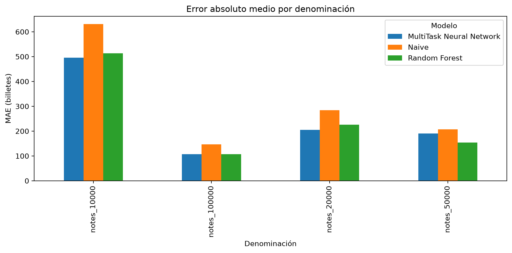
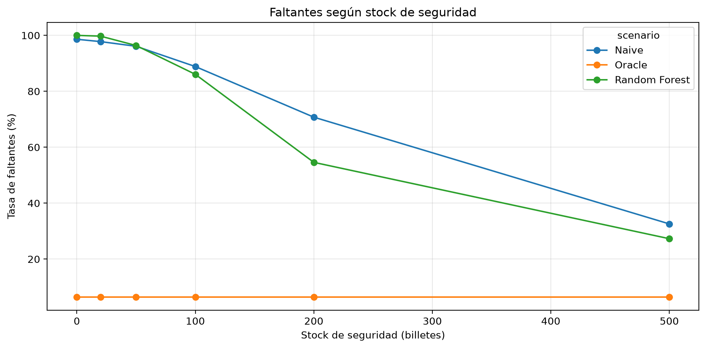
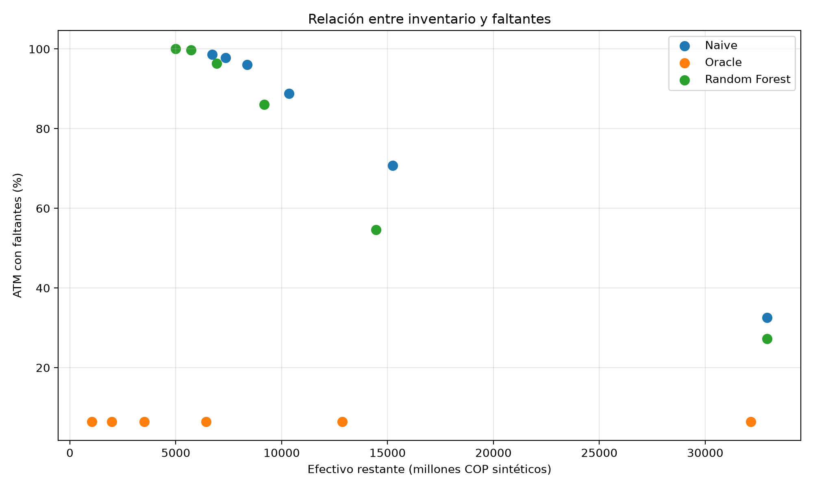
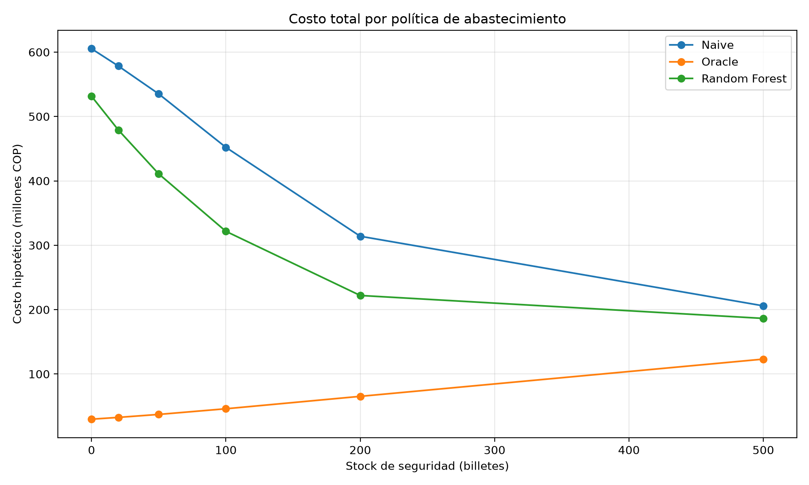

# Predicción de Demanda de Efectivo y Optimización de Reabastecimiento en Cajeros Automáticos (ATM)

Sistema integral de **Machine Learning** y **Simulación Operativa** diseñado para predecir la demanda diaria de efectivo por denominación de billetes y optimizar las políticas de reabastecimiento, el stock de seguridad y los costos logísticos en cajeros automáticos (ATM).

---

## Arquitectura y Estructura del Proyecto

```text
atm-cash-forecasting/
├── data/
│   ├── raw/                        # Datos crudos de transacciones (atm_transactions.csv)
│   └── processed/                  # Series diarias, demanda por denominación y tablas de evaluación
├── models/                         # Artefactos entrenados (.joblib y pesos .pt de PyTorch)
├── notebooks/
│   └── 01_exploracion_datos.ipynb  # Análisis exploratorio de datos (EDA)
├── reports/
│   ├── figures/                    # Gráficas de comparación de modelos, faltantes y costos
│   └── final_results_summary.csv   # Resumen consolidado de métricas y resultados
├── src/
│   ├── data/                       # Carga, limpieza e ingeniería de características
│   ├── models/                     # Entrenamiento, validación y auditoría temporal
│   └── simulation/                 # Simulador por denominación, stock de seguridad y costos
├── tests/                          # Pruebas unitarias de inventario, modelos y simulación
├── run_data_pipeline.py            # Ejecución del pipeline de datos y features
├── run_training.py                 # Entrenamiento de modelo baseline (Random Forest)
├── run_multioutput.py              # Entrenamiento de Random Forest Multi-Output
├── run_multitask.py                # Entrenamiento de Red Neuronal Multitarea (PyTorch)
├── run_operational_simulation.py   # Simulación operativa de inventario por denominación
├── run_economic_evaluation.py      # Evaluación financiera y trade-off de costos
├── run_full_pipeline.py            # Ejecución completa de extremo a extremo
└── requirements.txt                # Dependencias del entorno Python
```

---

## Enfoque Metodológico

1. **Ingeniería de Características y Auditoría Temporal:** Transformación del historial transaccional en series temporales diarias y por denominación, incorporando rezagos (*lags*), ventanas móviles y validaciones temporales estrictas (`run_temporal_audit.py`) para evitar fuga de datos (*data leakage*).
2. **Modelado Predictivo Multi-Enfoque:**
   * **Random Forest Baseline:** Predicción de demanda agregada diaria.
   * **Random Forest Multi-Output:** Predicción simultánea de demanda desagregada por denominación de billetes.
   * **Red Neuronal Multitarea (PyTorch):** Arquitectura profunda (`multitask_atm_network.pt`) entrenada conjuntamente sobre múltiples horizontes y denominaciones.
3. **Simulación Operativa y Optimización Económica:** Evaluación de políticas de reabastecimiento (Naive, Oracle y basadas en ML) midiendo tasas de desabastecimiento (*shortage rates*), nivel de servicio, stock óptimo de seguridad y costos totales de transporte y efectivo inmovilizado.

---

## Resultados Visuales

### Comparación de Desempeño de Modelos


### Tasa de Faltantes según Stock de Seguridad


### Balance entre Inventario y Desabastecimiento


### Evaluación Económica de Costos Operativos


---

## Instalación y Ejecución

1. **Clonar el repositorio:**
   ```bash
   git clone https://github.com/Alexandritoww/atm-cash-forecasting.git
   cd atm-cash-forecasting
   ```

2. **Crear y activar el entorno virtual:**
   ```bash
   python -m venv .venv
   # En Windows (Git Bash):
   source .venv/Scripts/activate
   ```

3. **Instalar dependencias:**
   ```bash
   pip install -r requirements.txt
   ```

4. **Ejecutar el pipeline completo:**
   ```bash
   python run_full_pipeline.py
   ```

5. **Ejecutar pruebas unitarias:**
   ```bash
   pytest
   ```

---

## Autor

**Johnny Alexander Rivera Palomares** — [@Alexandritoww](https://github.com/Alexandritoww)
